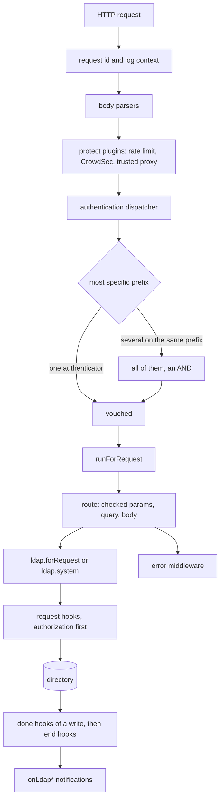
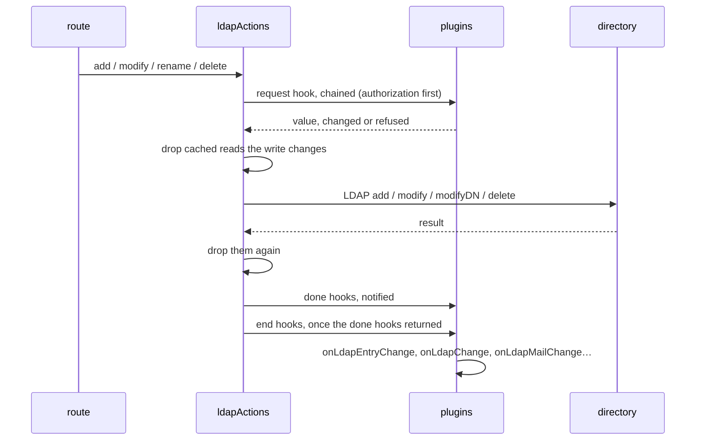

# Architecture

How the server is put together, and the two paths that carry most of the
work. Every design decision the code already embodies is recorded once, in
[`adr/`](adr/); this page is the map and the tour.

The plan that will split the repository into packages is
[Modularization plan](../development/modularization-plan.md). That plan is a
roadmap; this page describes the code as it is.

## Module map

| Path                             | Role                                                                                                                                                                                                                                 |
| -------------------------------- | ------------------------------------------------------------------------------------------------------------------------------------------------------------------------------------------------------------------------------------ |
| `packages/core/src/bin/index.ts` | `DM`: the Express app, plugin loading, the authentication dispatcher, `ready` and `stop`, `withConfig`                                                                                                                               |
| `src/bin/index.ts`               | The umbrella `DM`: the core server with the full option set and the plugin tree beside it                                                                                                                                            |
| `src/options.ts`                 | The complete option set: the core options plus every plugin family's declarations; the one composition root the umbrella keeps                                                                                                       |
| `packages/core/src/config/`      | Core command-line and environment options (`args.ts`), option specs (`options.ts`), plugin load order (`priority.json`), the entity-schema model (`schema.ts`; the directory's own schema is `packages/core/src/lib/ldap/schema.ts`) |
| `packages/core/src/abstract/`    | `DmPlugin` base class; `LdapFlat`, the entity CRUD built on it; `TwakePlugin`                                                                                                                                                        |
| `packages/core/src/hooks.ts`     | The hook type map: one entry per hook, with its arguments and its answer                                                                                                                                                             |
| `packages/core/src/lib/`         | Core services: `ldapActions` and `lib/ldap/` (pool, search cache, schema), `lib/auth/`, `lib/authz/`, `lib/services/`, `lib/storage/`, `hookBus`, `requestContext`, errors, routes                                                   |
| `packages/auth-*/`               | Authentication plugins and the guards that sit before them, one package per plugin                                                                                                                                                   |
| `packages/authz-*/`              | Authorization plugins, one package per plugin                                                                                                                                                                                        |
| `packages/storage/`              | Keyed storage (`core/storage`) and its `file`, `ldap`, `postgres` and `valkey` backends, each a `Store`                                                                                                                              |
| `src/plugins/ldap/`              | Directory plugins: groups, organizations, entities, change detection, trash, password policy                                                                                                                                         |
| `src/plugins/scim/`              | The SCIM 2.0 API                                                                                                                                                                                                                     |
| `src/plugins/twake/`             | Twake integrations: mail, calendar, spaces, drives, tombstones, lifecycle events                                                                                                                                                     |
| `src/plugins/*.ts`               | Standalone plugins: `static`, `weblogs`, `configApi`, `metrics`, `bcl`, and `rabbitmq` (a shared broker connection, not a store)                                                                                                     |
| `src/plugins/demo/`              | Example plugins                                                                                                                                                                                                                      |
| `src/browser/`                   | Browser libraries shipped with the package                                                                                                                                                                                           |
| `packages/core/src/logger/`      | Log formatting and levels                                                                                                                                                                                                            |
| `packages/core/src/types/`       | Shared TypeScript declarations                                                                                                                                                                                                       |

The plugin families depend on `packages/core/src/lib/` and on each other as documented in
[dependencies](../plugin-development/dependencies.md). The dependency rules
that the modularization will enforce are in the
[plan](../development/modularization-plan.md#target-architecture).

## Life of a request

1. `DM` mounts, in this order: the request id and log context
   (`runWithLogContext`), the media-type guard, the parsers a plugin
   registered for its own prefix, the global JSON and form parsers (they keep
   the raw bytes: HMAC authentication hashes them as the client signed them),
   the health probes, the protect and logging plugins, the authentication
   dispatcher, the plugin routes, and the error middleware, kept last.
2. The dispatcher picks the authentication whose path prefix is the most
   specific. Several plugins sharing that winning prefix all run, in
   registration order, and every one must let the request through: two
   credentials on one branch are an AND. A path nobody claims is guarded by
   the unscoped authenticators (no prefix), if any are loaded; with none, the
   request passes through unauthenticated, and `warnUnauthenticatedRoutes`
   names those routes at startup.
3. A plugin's `afterChain` runs after the whole selected chain and before any
   route: it is the only place where a verdict can depend on several
   authenticators without registration order deciding the answer.
4. `runForRequest(req, next)` wraps everything downstream of a request an
   authenticator let through — not the pass-through path, which has no
   caller. A directory operation made there, by whatever plugin, is judged as
   that caller even if the request object was not handed down. Hooks are the
   exception: they run as the server (see below), and a hook acting as the
   caller names the request it received. `ldap.system` is the explicit escape
   anywhere else.
5. A route declares its input schemas with `defineRoute`; the handler receives
   checked `params`, `query` and `body`, and reaches the directory through
   `ldap.forRequest(req)`. Work the server does for itself goes through
   `ldap.system`.
6. `ldapActions` raises the request hooks (authorization plugins first), makes
   the operation, then raises the "done" and "end" hooks of a write. The next
   section follows one.

The decisions behind these steps: [authentication
dispatch](adr/0002-authentication-dispatch.md), [authorization
composition](adr/0003-authorization-composition.md), [fail-closed request
context](adr/0004-fail-closed-request-context.md).

## Life of a write

- **Before the write.** A request hook is chained: each subscriber gets what
  the previous one answered, and a refusal thrown by any of them stops the
  operation. The request hooks of authorization plugins run before every
  other subscriber's, so a caller who may not make the operation is refused
  before a plugin judges its content.
  [trash](adr/0007-trash-and-tombstone.md) and
  [tombstone](adr/0007-trash-and-tombstone.md) use this point to replace a
  delete.
- **The write.** `ldapActions` drops the cached reads of what it is about to
  change before the directory call and again once it returned, so a read
  landing during the round trip cannot serve what the write replaced.
  [Search cache](adr/0006-search-cache.md).
- **After the write.** `ldapadddone`, `ldapmodifydone`, `ldapdeletedone` and
  `ldaprenamedone` are notified, not awaited. `ldapaddafter` is awaited
  within the request, for what must follow an add, such as provisioning the
  account the entry describes. Once the done subscribers returned, the
  matching `ldapmodifyend`, `ldapdeleteend` or `ldaprenameend` fires, whether
  the write landed, was refused or was taken out of the request.
- **Derived notifications.** `core/ldap/onChange` reads the entry before and
  after the write and raises `onLdapEntryChange`, then the attribute-specific
  ones (`onLdapMailChange`, `onLdapQuotaChange`, …). A delete fires
  `onLdapEntryChange`, `onLdapChange` and `onLdapMailChange` only.
- **Contract.** [Hook contract](adr/0005-hook-contract.md), and the reference
  of every hook in [hooks](../plugin-development/hooks.md). Subscribers run as
  the server, outside the request that raised the hook; one that acts as the
  caller names the request in its arguments.

## Startup

The configuration is parsed from the command line and `DM_*` variables, then
`DM` loads the plugins: `packages/core/src/config/priority.json` first, one at a time in
its order, then the rest in parallel. Once every load settled, the server
checks the authorization composition, learns the directory's attribute types
when an authorization plugin is loaded, reports unknown options and runs
`afterLoad`. `DM.ready` resolves then, and rejects if a plugin failed to load;
the CLI opens the port after it. An embedding host may register plugins after
`ready`, and each registration is checked against the composition too.
`warnUnauthenticatedRoutes` stays silent when no authentication plugin is
loaded; the enforcement check says once whether that is an open server or a
configuration to refuse.

[Plugin load order](adr/0001-plugin-load-order.md),
[server views](adr/0008-withconfig-views.md).

## Decision records

| Record                                          | Decision                                                                                |
| ----------------------------------------------- | --------------------------------------------------------------------------------------- |
| [0001](adr/0001-plugin-load-order.md)           | Plugins load priority-first, then in parallel; dependencies load on demand              |
| [0002](adr/0002-authentication-dispatch.md)     | The most specific authentication prefix wins; several on one prefix are an AND          |
| [0003](adr/0003-authorization-composition.md)   | Two authorization models judging the same requests are refused unless made deliberate   |
| [0004](adr/0004-fail-closed-request-context.md) | Directory operations inherit the request being served; `ldap.system` is the escape      |
| [0005](adr/0005-hook-contract.md)               | Chained hooks transform and refuse; notified hooks observe, outside the request         |
| [0006](adr/0006-search-cache.md)                | The search cache is off by default and only the process's own writes invalidate it      |
| [0007](adr/0007-trash-and-tombstone.md)         | A delete becomes a move to trash or a tombstone, never a loss                           |
| [0008](adr/0008-withconfig-views.md)            | A plugin with overrides sees a server view that shares everything but the configuration |

## Checking the comments

`npm run check:comments` (`scripts/check-comments.sh`) refuses new comments in
`src/` and in every package's `src/` that cite an issue number, narrate history
("used to", "since 1.2") or otherwise carry rationale. The rationale belongs
in a decision record; the comment points at it. The accepted set is
`scripts/comment-baseline.txt`, and
it may only shrink: removing a comment is fine, adding one fails the check.
`sh scripts/check-comments.sh --update` rewrites the baseline from the current
tree when a change removes one.
